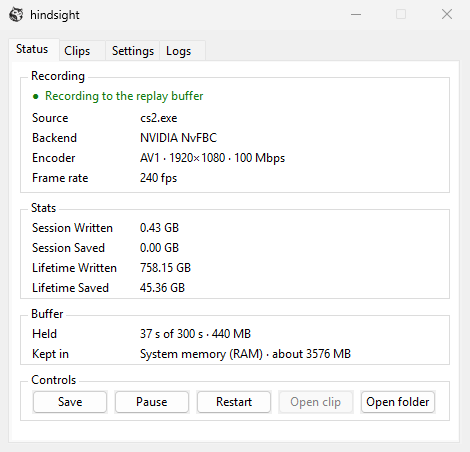

# hindsight

  

**Save clips of your game after they happen.**

hindsight quietly records your game in the background, keeping only the last few moments. When something worth keeping happens, press **Alt+F7** and what you just played is saved as a video. You never have to remember to hit record first.

It does the same job as NVIDIA's Instant Replay (part of ShadowPlay) with less overhead: captured and encoded on the GPU, no overlay, no launcher, no bloat.

- **A tray icon and one small window.** No overlay, no account, no launcher.
- **Cheaper than Instant Replay.** Less CPU and fewer lost frames than NVIDIA's at the same settings, measured in-game.
- **Keep anywhere from 5 seconds to 10 minutes**, buffered in RAM, VRAM or on disk.
- **H.264, HEVC or AV1** at up to 240 fps, with system sound and, if you like, your microphone as AAC, saved as MP4 or MKV. Screenshots as PNG, JPEG, WebP or AVIF.

  

You need **64-bit Windows 10 version 1903 or newer**, and an **NVIDIA GPU** with a current driver (531 or newer).

## Get started

1. Download **`hindsight-setup-x64.exe`** from the [Releases page](https://github.com/malinoskj2/hindsight/releases) and run it.
2. Launch **hindsight** from the Start menu. It waits for a full-screen app, then records it.
3. Play. When something happens that you want to keep, press **Alt+F7** (or the hotkey you set) to save what just happened as a clip, or **Alt+F8** to save a screenshot. Clips go into the `videos` folder and screenshots into the `screenshots` folder of the clip folder, `Videos\hindsight` unless you choose another. The Clips and Screenshots tabs list them newest first: click one to open it, or right-click it to show it in Explorer or delete it.
4. Optional: read [Getting the best performance](docs/performance.md) for what each setting costs and what to choose for your hardware.

hindsight looks for a newer release when it starts and once a day, and the About tab's **Update** button installs it. Each installer is signed, and hindsight runs only one whose signature it can verify. Turn **Check for updates** off in Settings to stop the checks.

## How it stays light

- **Nothing touches the CPU's memory.** Each frame is copied once, on the GPU, into a texture NVENC owns, and NVENC converts and encodes it on its own silicon. With NvFBC the encoder reads the grab where the driver left it, so even that copy goes.
- **The CPU never reads the video.** NVENC reports each frame's type, so packets go into the buffer without being parsed.
- **Nothing polls.** A waitable timer wakes the capture thread once per frame, in the multimedia scheduling class, and three encode slots rotate so it never waits on the GPU.
- **Nothing runs on the shader cores.** Single-pass rate control, no B-frames, no lookahead, no adaptive quantization. An unchanged screen is repeated GPU-side.
- **Capture gets the GPU first.** High GPU thread and scheduling priority, never realtime, and no power throttling.
- **Sound is kept raw** and mixed and encoded to AAC only when you save, on the saving thread. The microphone is read on the same thread as system sound and kept in mono. Long silences are dropped.
- **Screenshots cost nothing until you take one.** A screenshot is of the whole monitor in front, whether or not anything is recording. The capture thread looks for a request with one atomic read per frame: when it records that monitor, or the game in front, the screenshot copies the picture the encoder was given on the GPU. Otherwise a background thread captures the monitor once, tone-mapped on an HDR display. Either way a background thread reads the picture back and writes the file.
- **Saves run in the background** at low CPU, I/O and memory priority, so they never compete with the game.

Run as administrator for the highest GPU priority. To check for yourself, compare CPU use and frame times (PresentMon or CapFrameX) with hindsight, with Instant Replay and with neither.

## To do

- AMD GPU support
- Linux support

## Contributing

Bug reports and pull requests are welcome, and you do not need to know Rust or GPU programming to help. See [CONTRIBUTING.md](CONTRIBUTING.md).

## License

[BSD 2-Clause](LICENSE).
